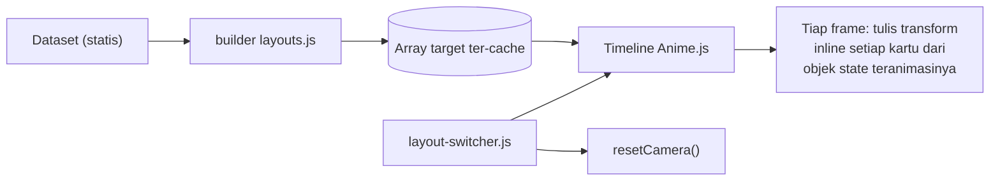
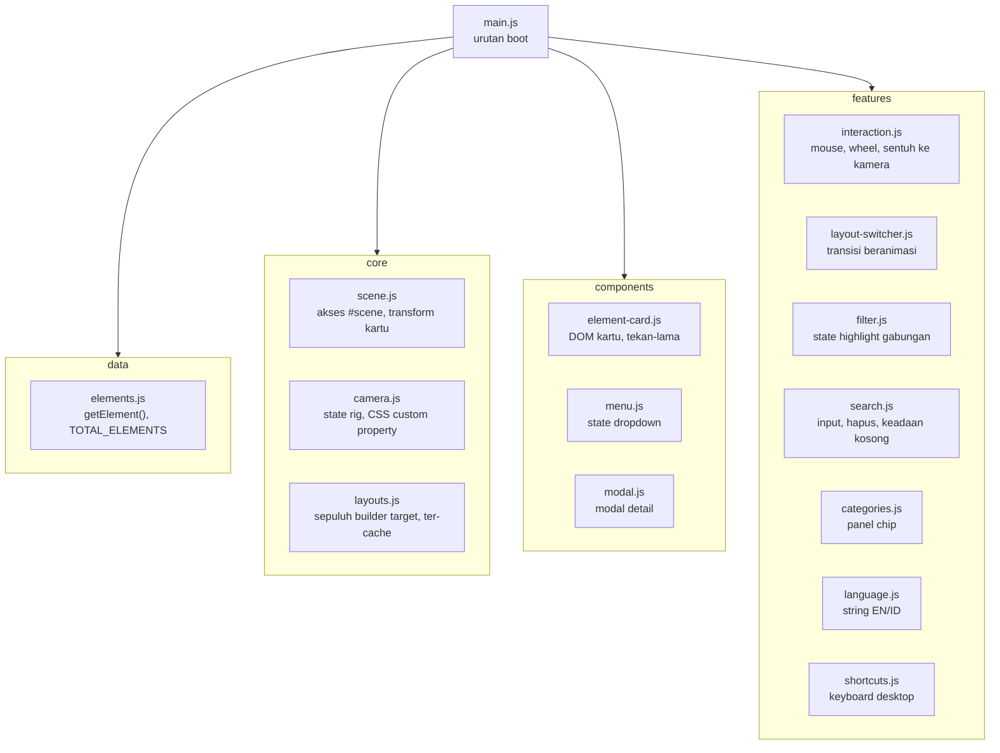

<h1 align="center">3D Periodic Table</h1>

<p align="center">
  Seluruh 118 unsur dalam ruang 3D, dibangun dengan CSS transform murni.<br>
  Sepuluh layout beranimasi, pencarian langsung, filter kategori, dan tanpa build step.
</p>

<p align="center">
  
  
  
  
  
  
</p>

<p align="center">
  <a href="#ringkasan">Ringkasan</a> ·
  <a href="#layout">Layout</a> ·
  <a href="#mulai-cepat">Mulai cepat</a> ·
  <a href="#penggunaan">Penggunaan</a> ·
  <a href="#arsitektur">Arsitektur</a> ·
  <a href="#konfigurasi">Konfigurasi</a> ·
  <a href="#kustomisasi">Kustomisasi</a> ·
  <a href="#referensi">Referensi</a> ·
  <a href="#faq">FAQ</a>
</p>

<p align="center">
  <a href="./README.md">English</a> · <b>Bahasa Indonesia</b>
</p>

<!-- Tambahkan tautan demo dan screenshot atau GIF di sini jika sudah tersedia. -->

---

## Ringkasan

Visualisasi interaktif tabel periodik lengkap. Seluruh 118 unsur menjadi kartu yang ditempatkan di ruang 3D dengan CSS transform. Putar, geser, dan zoom scene, tahan unsur mana pun untuk melihat detailnya, ganti antara sepuluh layout dengan transisi beranimasi, cari secara instan, dan sorot seluruh keluarga unsur dengan filter kategori.

> [!NOTE]
> **Tanpa build step, tanpa framework, tanpa instalasi.** Proyek ini berupa HTML, CSS, dan ES module biasa yang disajikan secara statis, sekitar 2.800 baris kode vanilla. Anime.js, Font Awesome, dan Google Fonts dimuat dari CDN saat runtime.

### Fitur utama

| | |
|:--|:--|
| **118 kartu unsur** | Tema warna per kategori dengan 10 palet |
| **10 layout** | Table, Sphere, Helix, Grid, Rings, Cylinder, Wave, DNA, Vortex, Torus, dengan transisi Anime.js berjeda (stagger) |
| **Kontrol kamera penuh** | Drag untuk memutar, drag kanan atau drag dua jari untuk menggeser, roda mouse atau pinch untuk zoom |
| **Modal detail** | Tekan lama (0,5 detik) menampilkan massa, massa jenis, titik leleh, dan titik didih |
| **Pencarian langsung** | Berdasarkan nama (dalam kedua bahasa UI), simbol, atau nomor atom. Yang cocok menyala sementara sisanya memudar, di setiap layout |
| **Filter kategori** | Sepuluh chip toggle yang bisa dikombinasikan dengan pencarian. Panel terbuka sesuai permintaan, awalnya tertutup, dan ditutup dengan tap di luar panel atau `Esc` |
| **Shortcut keyboard** | Khusus desktop, dengan overlay referensi di dalam aplikasi |
| **UI dwibahasa** | Inggris dan Indonesia, terdeteksi otomatis dari locale browser |
| **Siap untuk mobile** | Mendukung safe area pada perangkat berponi, gestur sentuh disetel untuk ponsel |

---

## Layout

Setiap layout adalah fungsi murni dari dataset menjadi satu target `{x, y, z, rx, ry, rz}` per kartu, dibangun sekali lalu di-cache. Satu timeline Anime.js menerbangkan seluruh 118 kartu ke target barunya dengan stagger.

| Key | Shortcut | Bentuk |
|:--|:--:|:--|
| `table` | `1` | Tabel periodik klasik yang datar: 18 kolom × 7 periode, dengan deret blok-f di dua baris tambahan di bawahnya. |
| `sphere` | `2` | Distribusi bola Fibonacci, kartu menghadap keluar dari pusat (skema jarak yang sama dengan demo CSS3D klasik). |
| `helix` | `3` | Satu spiral vertikal: kartu naik sambil mengelilingi sumbu Y, selalu menghadap keluar. |
| `grid` | `4` | 118 kartu ditumpuk sebagai irisan 5 × 5 yang menjauh ke belakang sepanjang −Z. |
| `rings` | `5` | Satu cincin konsentris per periode, bertingkat turun seperti kue pernikahan yang miring. Deret blok-f menempati dua cincin terluar. |
| `cylinder` | `6` | 18 kolom golongan dililitkan mengelilingi sumbu vertikal (golongan 1 dan 18 bertemu di sambungan), setiap periode berupa pita horizontal. |
| `wave` | `7` | Tabel datar dengan offset sinus yang bergerak pada kedalaman. Kartu tetap menghadap depan sehingga semuanya tetap terbaca. |
| `dna` | `8` | Dua untai yang saling berpilin: nomor atom ganjil dan genap bergantian di sisi setiap anak tangga. |
| `vortex` | `9` | Spiral Archimedes dengan tepat satu putaran penuh per periode (logam alkali membuka tiap putaran, gas mulia menutupnya), naik perlahan membentuk kerucut. Blok-f berada di dua cincin di dalam putaran pertama. |
| `torus` | `0` | Sebuah donat: 18 golongan melilit tabung sehingga tabel menutup pada dirinya sendiri, 7 periode berada di penampang tabung (periode 1 di puncak), dan blok-f menggantung sebagai dua cincin bertumpuk di dalam lubang. |

> [!TIP]
> Rings, vortex, dan torus dibangun datar pada bidang XZ lalu dimiringkan ke arah kamera sebagai transform kaku, sehingga siluetnya terbaca dari sudut pandang awal. Kartu torus juga condong mengikuti permukaan tabung, dan separuh bagian dalam tabung dibalik keluar terlebih dahulu agar tidak ada kartu sisi dekat yang menampilkan sisi belakangnya.

---

## Mulai cepat

> [!IMPORTANT]
> Aplikasi ini memakai ES module native, jadi **harus disajikan lewat HTTP**. Membuka `index.html` melalui `file://` gagal memuat module di sebagian besar browser.

```bash
# dari root proyek, server file statis apa pun bisa dipakai
python3 -m http.server 8000
# atau
npx serve .
```

Lalu buka `http://localhost:8000`.

### Deploy

Tidak ada perintah build dan tidak ada direktori output. Root repositori adalah artefak yang di-deploy.

| Host | Pengaturan |
|:--|:--|
| **GitHub Pages** | Push folder ke repositori, lalu Settings → Pages → deploy dari root branch |
| **Netlify · Cloudflare Pages · Vercel** | Gunakan preset static site, biarkan build command kosong |

Aset CDN (Anime.js, Font Awesome, Google Fonts) diambil saat runtime, jadi pengunjung membutuhkan akses internet.

---

## Penggunaan

### Kontrol

| Input | Aksi |
|:--|:--|
| Drag kiri (mouse) · drag satu jari (sentuh) | Memutar scene |
| Drag kanan (mouse) · drag dua jari (sentuh) | Menggeser (pan) |
| Roda mouse · pinch (sentuh) | Zoom |
| Tekan dan tahan unsur (0,5 detik) | Membuka modal detail |
| Tombol hamburger (kiri atas) | Pemilih layout dan pengalih bahasa |
| Kolom pencarian (kanan atas) | Mencari unsur berdasarkan nama, simbol, atau nomor |
| Tombol bentuk (kiri bawah) | Chip filter kategori |

<details>
<summary><b>Cara gestur diatur</b></summary>
<br>

Tekanan yang dimulai pada kartu unsur lebih dulu menjadi milik gestur tekan-lama kartu itu. Kamera baru mulai mengikutinya setelah pointer bergerak lebih dari `SCENE_DRAG_THRESHOLD_PX` (10 px) dari titik awal, dan saat itu tahanan yang tertunda dibatalkan. Tekanan pada ruang kosong langsung menggerakkan kamera. Pemisahan ini menjaga "tahan untuk membuka detail" tetap andal sambil mempertahankan drag-untuk-memutar dari mana saja.

Tahanan dibatalkan ketika pointer bergeser lebih dari 12 px, keluar dari kartu, diinterupsi sistem, atau ketika jari kedua bergabung (yang mengubah gestur menjadi pinch). Pinch aktif seketika dan melakukan zoom berdasarkan jarak antar jari.

Selama transisi layout, kartu mengabaikan pointer sepenuhnya (`is-transitioning`), sehingga tekanan tidak pernah mendarat di kartu yang kebetulan sedang melintas di bawahnya.

</details>

### Shortcut keyboard

Khusus desktop.

| Tombol | Aksi |
|:--|:--|
| `1`–`9`, `0` | Ganti layout (table, sphere, helix, grid, rings, cylinder, wave, DNA, vortex, torus) |
| `E` / `I` | Ganti bahasa (Inggris / Indonesia) |
| `R` | Reset kamera |
| `/` | Fokus ke kolom pencarian |
| `?` | Tampilkan atau sembunyikan overlay shortcut |
| `Esc` | Tutup modal → menu → kategori → overlay (yang paling atas lebih dulu) |

Shortcut satu tombol dinonaktifkan saat mengetik di kolom pencarian dan saat tombol modifier ditekan, sehingga tidak pernah menelan input biasa atau shortcut browser. Pada perangkat yang mengutamakan sentuhan, tombol bantuan dan seluruh binding keyboard dinonaktifkan sepenuhnya, karena tidak ada keyboard fisik yang perlu dilayani.

### Pencarian dan filter kategori

Pencarian dan chip kategori memakai satu mesin highlight bersama (`js/features/filter.js`), sehingga keduanya saling melengkapi dan tidak berebut kartu yang sama.

- Kartu **menyala** ketika cocok dengan query aktif (jika ada) **dan** termasuk kategori aktif (jika ada).
- **Query numerik** dicocokkan secara prefiks dengan nomor atom. Selain itu dicocokkan dengan simbol atau nama Inggris/Indonesia, tanpa membedakan huruf besar dan kecil.
- Pengetikan di-debounce (120 ms) dan kombinasi filter yang identik dilewati, jadi input cepat tidak membebani 118 gaya kartu tanpa alasan.
- Saat tidak ada yang cocok, gelembung keadaan kosong kecil muncul di bawah kolom pencarian.
- Kartu yang diredupkan memudar ke keadaan hantu dan keluar dari hit-testing sepenuhnya (`pointer-events: none`), sehingga tekanan untuk kartu yang menyala tidak pernah mendarat di kartu pudar yang menumpuk di depannya.
- `Esc` di dalam kolom pencarian mengosongkannya (atau melepas fokus jika sudah kosong). Rantai `Esc` global tidak bereaksi pada tekanan yang sama.
- Mengosongkan input mengembalikan scene ke keadaan kategori jika chip masih aktif, dan ke tampilan istirahat setelah semua filter mati.

Panel kategori awalnya tertutup, menutup saat chip-nya diketuk (hanya panel yang beralih), dan menutup pada tekanan di luar panel. Titik indikator pada tombol bentuk menandakan filter masih aktif setelah panel tertutup.

### Bahasa

UI tersedia dalam bahasa Inggris dan Indonesia. Saat pertama dimuat, bahasa dipilih dari locale browser (tag bahasa `id` atau tag wilayah `id` memilih bahasa Indonesia). Semuanya diterjemahkan:

- label bagian menu, nama layout, dan pengalih bahasa
- placeholder pencarian, tombol hapus, dan pesan tidak ada hasil
- nama chip kategori
- petunjuk interaksi, label kolom modal, dan overlay shortcut
- setiap judul unsur pada kartu (misalnya *Sodium* ↔ *Natrium*)

Markup statis mendeklarasikan string-nya dengan `data-i18n` (teks), `data-i18n-ph` (placeholder), atau `data-i18n-aria` (aria-label). Konsumen dinamis memanggil `translate()` atau berlangganan dengan `onLanguageChange()`. Nilai properti unsur di modal (massa, massa jenis, suhu) ditampilkan persis seperti tersimpan di dataset.

---

## Arsitektur

### Model rendering

Tidak ada WebGL. `<body>` membawa CSS `perspective` (1200 px). `#scene` adalah kotak berukuran nol yang berlabuh di pusat viewport dan membawa seluruh transform kamera. Ke-118 kartu adalah anak langsungnya, masing-masing digerakkan dengan `translate3d(...) rotateY(...) rotateX(...) rotateZ(...)` inline miliknya sendiri.

> [!WARNING]
> Jaga transform kamera tetap pada satu tingkat. Container `preserve-3d` bersarang yang bertransform membuat Chromium sama sekali tidak mendeteksi kartu saat hit-testing, itulah sebabnya rig sengaja tidak dipecah menjadi pembungkus kamera dan rotator.

### Rig kamera

`js/core/camera.js` memiliki lima nilai (`camX`, `camY`, `camZ`, `rotX`, `rotY`) dan menuliskannya ke root dokumen sebagai CSS custom property (`--cam-x` … `--rot-y`) di dalam loop `requestAnimationFrame` yang hanya menyentuh DOM ketika ada nilai yang benar-benar berubah. Translasi dibatasi pada `[CAMERA_MIN_Z, CAMERA_MAX_Z]` dan pitch pada ±90°.

Input dari `js/features/interaction.js` datang sebagai pemanggilan mutator kecil (`addRotation`, `addPan`, `addZoom`, `setPinchZoom`). `resetCamera()` menganimasikan rig kembali ke pose netralnya dan berjalan setelah setiap pergantian layout.

### Pipeline layout



Builder mengembalikan satu entri `{x, y, z, rx, ry, rz}` per indeks dataset (0–117). Rotasi dalam radian dan cocok dengan urutan transform yang diterapkan oleh `formatElementTransform()`. Pada layout melingkar, kartu menghadap menjauhi sumbu Y vertikal (`ry = theta`), itulah sebabnya bentuk horizontal mengukur sudutnya dari +Z, ke arah kamera awal.

### Graf module



### Urutan boot

`main.js` menyambungkan semuanya dalam urutan yang disengaja:

1. **Menu dan modal**, karena kartu menargetkan keduanya
2. **118 kartu**
3. **Registry fitur**: bahasa, layout switcher, filter
4. **Pencarian dan kategori**, agar string-nya sudah ada sebelum pass bahasa pertama
5. **Bahasa dan layout awal**
6. **Input kamera dan shortcut desktop**, sehingga setiap permukaan yang mungkin mereka tutup sudah siap ketika gestur pertama tiba

### Struktur proyek

```text
index.html                  markup: menu, pencarian, kategori, shortcut, scene, modal
css/
  variables.css             design token, palet kategori, variabel kamera
  main.css                  gaya dasar dan petunjuk interaksi
  menu.css                  hamburger, panel dropdown, pengalih bahasa
  search.css                kolom pencarian dan gelembung keadaan kosong
  categories.css            tombol kategori dan panel chip
  shortcuts.css             tombol bantuan shortcut dan overlay
  periodic-table.css        hierarki scene 3D, kartu unsur, state filter
  modal.css                 modal detail unsur
  responsive.css            penyesuaian layar kecil dan sentuh
js/
  main.js                   entry point: penyambungan dan urutan boot
  data/
    elements.js             dataset (10 field per unsur, stride tetap)
  core/
    scene.js                akses DOM scene, transform kartu
    camera.js               state rig kamera, output CSS custom property
    layouts.js              semua builder target sepuluh layout (table … torus)
  components/
    element-card.js         DOM kartu + gestur tekan-lama
    menu.js                 state buka/tutup dropdown
    modal.js                pengisian dan penutupan modal detail
  features/
    interaction.js          pipeline input mouse/wheel/sentuh
    language.js             string EN/ID dan pergantian label
    layout-switcher.js      transisi layout beranimasi
    filter.js               mesin highlight gabungan pencarian + kategori
    search.js               input pencarian, hapus, pesan keadaan kosong
    categories.js           chip kategori dan state buka/tutup panel
    shortcuts.js            binding keyboard desktop dan overlay referensi
  utils/
    helpers.js              konstanta bersama dan utilitas kecil
archive/
  index.html                versi satu-file yang asli, disimpan sebagai referensi
```

> [!NOTE]
> Setiap module JS dibuka dengan komentar blok yang menjelaskan tanggung jawabnya dan keputusan-keputusan tidak kasat mata di dalamnya. Komentar-komentar itu adalah dokumen desainnya.

---

## Konfigurasi

Semua konstanta penyetelan ada di `js/utils/helpers.js`.

<details open>
<summary><b>Kamera dan input</b></summary>
<br>

| Konstanta | Nilai | Arti |
|:--|:--|:--|
| `CAMERA_DEFAULT_Z` | `-2600` | Jarak kamera awal |
| `CAMERA_MIN_Z` / `CAMERA_MAX_Z` | `-6000` / `-500` | Batas zoom |
| `ROTATION_MIN_X` / `ROTATION_MAX_X` | `-90°` / `90°` | Batas pitch |
| `MOUSE_ROTATE_GAIN` | `0.3` | Piksel pointer → rotasi |
| `MOUSE_PAN_GAIN` / `TOUCH_PAN_GAIN` | `2.5` | Piksel pointer → geser |
| `WHEEL_ZOOM_GAIN` | `2.0` | Δ roda → zoom |
| `TOUCH_ROTATE_GAIN` | `0.4` | Piksel sentuh → rotasi |
| `TOUCH_PINCH_GAIN` | `5.0` | Piksel jarak jari → zoom |
| `SCENE_DRAG_THRESHOLD_PX` | `10` | Titik pemisah drag vs tahan |
| `ELEMENT_HOLD_DURATION_MS` | `500` | Durasi tahan-untuk-modal |
| `ELEMENT_HOLD_DRIFT_PX` | `12` | Toleransi getaran saat menahan |

</details>

<details>
<summary><b>Animasi</b></summary>
<br>

| Konstanta | Nilai | Arti |
|:--|:--|:--|
| `ANIME_LAYOUT_DURATION_MS` | `2000` | Penerbangan layout, desktop |
| `ANIME_LAYOUT_STAGGER_MS` | `12` | Jeda per kartu, desktop |
| `ANIME_LAYOUT_DURATION_TOUCH_MS` | `1200` | Penerbangan layout, perangkat sentuh |
| `ANIME_LAYOUT_STAGGER_TOUCH_MS` | `7` | Jeda per kartu, perangkat sentuh |
| `ANIME_CAMERA_RESET_MS` | `1500` | Penerbangan reset kamera |

</details>

<details>
<summary><b>Geometri layout</b></summary>
<br>

| Layout | Konstanta utama |
|:--|:--|
| Table | Jarak sel 150 × 190 px, pusat grid kolom 9,5 / baris 5,5 |
| Sphere | Radius 1100 (distribusi Fibonacci) |
| Helix | Radius 1000, 0,175 rad per unsur, naik −10 px per unsur |
| Grid | Irisan 5 × 5, jarak 400 px, berjarak 1000 px pada kedalaman |
| Rings | Radius 230 + 95 per cincin, turun 200 px per tingkat, kemiringan 0,32 rad |
| Cylinder | Radius 460, jarak pita 190 px, blok-f menyelip 1,4 baris di bawah periode 7 |
| Wave | Amplitudo 260, frekuensi 0,6 (kolom) / 0,5 (baris) |
| DNA | Radius 650, 0,42 rad per anak tangga, naik 11 px |
| Vortex | Radius 520 + 95 per putaran, naik 150 px per putaran, radius lubang blok-f 360 |
| Torus | Radius utama 900, tabung 220, cincin lubang di 560, kemiringan 0,58, pitch permukaan 0,42 |

Dimensi kartu (`--w: 130px`, `--h: 170px`) dan sepuluh warna kategori (`--c-0` … `--c-9`) adalah CSS custom property di `css/variables.css`.

</details>

---

## Kustomisasi

### Mengubah warna kategori

Ubah `--c-0` … `--c-9` di `css/variables.css`. Triplet warnanya dipakai di mana-mana lewat `rgba(var(--color-rgb), α)`, jadi mengubah satu baris menata ulang tema seluruh keluarga: kartu, chip, warna modal, dan glow.

### Mengubah ukuran kartu

`--w` dan `--h` di `css/variables.css` menentukan kotak kartu. `TABLE_CELL_W` dan `TABLE_CELL_H` di `helpers.js` menentukan jarak pada layout table.

> [!TIP]
> Jaga nilai sel sama dengan atau lebih besar dari nilai kartu agar kartu yang bersebelahan tidak saling tumpang tindih pada layout table.

### Menambah layout baru

Lima titik sentuh, sekitar 50 baris:

| # | File | Perubahan |
|:-:|:--|:--|
| 1 | `js/utils/helpers.js` | Konstanta geometri untuk bentuknya |
| 2 | `js/core/layouts.js` | Builder yang mengembalikan satu `{x, y, z, rx, ry, rz}` per indeks, konstanta namanya yang diekspor, entri di `LAYOUT_NAMES`, accessor `get<Name>Layout()` (caching mengikuti pola yang ada), dan sebuah `case` di `getLayout()` |
| 3 | `index.html` | Sebuah `.layout-item` dengan `data-layout="myshape"` dan `id="lbl-myshape"` |
| 4 | `js/features/language.js` | `myshape: 'MyShape'` di kedua tabel string `EN` dan `ID` |
| 5 | `js/features/shortcuts.js` | Binding tombol di `onKeyDown()`, ditambah baris yang cocok pada markup overlay shortcut jika ingin didokumentasikan di dalam aplikasi |

Sisanya tersusun otomatis: transisi stagger, reset kamera, tahan-untuk-klik, glow pencarian, filter kategori, dan state aria semuanya bekerja pada tingkat kartu dan tidak butuh kode per layout.

### Mengedit dataset

`js/data/elements.js` adalah array datar dengan stride tetap 10 field string/angka per unsur (lihat [Skema dataset](#skema-dataset)). Pertahankan urutan nomor atom menaik: nomor atom diturunkan dari indeks array, dan beberapa layout mengurutkan kartu berdasarkan indeks.

---

## Referensi

### Catatan performa

Deteksi perangkat sentuh, `matchMedia('(hover: none) and (pointer: coarse)')`, dipakai bersama oleh setiap fitur yang bercabang berdasarkan gaya input, sehingga CSS dan JS tetap konsisten.

| Teknik | Efek |
|:--|:--|
| **Animasi lebih singkat di sentuh** | Koreografi 118 kartu berjalan pada jam 1200 ms dengan stagger 7 ms (dibanding 2000 ms / 12 ms di desktop), sehingga lebih sedikit detik penulisan gaya per frame menjaga pergantian tetap mulus di GPU mobile |
| **Render kartu lebih ringan di sentuh** | Box-shadow berlapis dan text-shadow simbol, efek termahal per kartu, dihilangkan. Border dan isian membawa tampilannya, dan satu glow dipertahankan hanya untuk state menyala dan ditekan |
| **Backdrop blur lebih sedikit** | Permukaan UI tetap memakai latar solid di perangkat sentuh. Hanya dua panel yang mempertahankan blur yang dikurangi |
| **Output kamera dengan dirty flag** | CSS custom property hanya ditulis pada frame ketika sebuah nilai benar-benar berubah |
| **Kunci transisi** | `is-transitioning` menonaktifkan pointer event kartu selama penerbangan, mencegah hit-test sia-sia dan salah tekan |
| **Kartu redup keluar dari hit-testing** | Tap terasa instan saat filter aktif |
| **Kerja statis dilakukan sekali** | Target layout di-cache setelah pembangunan pertama, filter melewati pass berlebih lewat kunci applied-state, dan input pencarian di-debounce |

### Aksesibilitas

- Setiap kontrol adalah `<button>` sungguhan dengan `aria-label` yang dilokalkan. Hamburger, panel kategori, dan tombol bantuan mengekspos `aria-expanded`.
- Entri menu layout adalah `role="button"` dengan `tabindex="0"`, state `aria-pressed`, dan aktivasi Enter/Space. Chip kategori juga mengekspos `aria-pressed`.
- Overlay shortcut adalah `role="dialog"` dengan `aria-modal="true"`. `Esc` menutup permukaan sesuai urutan prioritas (modal → menu → kategori → overlay).
- Semua elemen interaktif menampilkan outline `:focus-visible` yang terlihat dalam warna aksen.
- Target sentuh di layar kecil memenuhi minimum 44 px, dan panel menghormati safe-area inset pada perangkat berponi.

### Skema dataset

`js/data/elements.js` menyimpan setiap unsur sebagai 10 field berurutan.

| Offset | Field | Tipe | Contoh (Aluminium) |
|:-:|:--|:--|:--|
| 0 | `symbol` | string | `'Al'` |
| 1 | `nameEN` | string | `'Aluminium'` |
| 2 | `nameID` | string | `'Aluminium'` |
| 3 | `category` | 0–9 | `6` (post-transisi) |
| 4 | `column` | 1–18 | `13` |
| 5 | `row` | 1–10 | `3` |
| 6 | `mass` | string | `'26.981 u'` |
| 7 | `density` | string | `'2.7 g/cm³'` |
| 8 | `meltingPoint` | string | `'660.32 °C'` |
| 9 | `boilingPoint` | string | `'2469.85 °C'` |

**Indeks kategori** dipetakan ke `--c-0` … `--c-9` di `css/variables.css`:

| 0 | 1 | 2 | 3 | 4 |
|:-:|:-:|:-:|:-:|:-:|
| Nonlogam | Gas mulia | Logam alkali | Alkali tanah | Metaloid |

| 5 | 6 | 7 | 8 | 9 |
|:-:|:-:|:-:|:-:|:-:|
| Halogen | Logam pasca-transisi | Logam transisi | Lantanida | Aktinida |

Catatan:

- Nomor atom **tidak disimpan**. Nilainya adalah indeks array + 1.
- `column` dan `row` menggerakkan layout table dan wave. Blok-f berada di baris 9–10 di bawah grid utama.
- Nilai ditampilkan apa adanya, jadi data yang kosong muncul sebagai `N/A`, dan titik sublimasi karbon tertulis `Menyublim`.

### Dukungan browser

Browser modern apa pun dengan CSS 3D transform, ES module, dan pointer event.

| Chrome / Edge | Firefox | Safari |
|:-:|:-:|:-:|
| 89+ | 89+ | 15+ |

Proyek ini menargetkan browser evergreen dan tidak menyertakan polyfill.

### Keterbatasan yang diketahui

> [!WARNING]
> - Modal detail hanya bisa dijangkau lewat gestur tahan. Tidak ada jalur khusus keyboard untuk membukanya.
> - Gerakan tidak mengikuti `prefers-reduced-motion`. Aplikasi ini memang pada dasarnya beranimasi.
> - Beberapa nilai dataset memuat token bahasa Indonesia (`Menyublim`) terlepas dari bahasa UI yang aktif.
> - Pada layar yang sangat pendek, menu geser bisa di-scroll. Tingginya dibatasi `100dvh − 90px` secara sengaja agar tetap terjangkau.

---

## FAQ

<details>
<summary><b>Tidak ada yang tampil saat saya membuka <code>index.html</code> langsung.</b></summary>
<br>
ES module membutuhkan HTTP. Sajikan foldernya (<code>python3 -m http.server 8000</code>, <code>npx serve .</code>, atau host statis apa pun) dan buka lewat itu.
</details>

<details>
<summary><b>Ikon atau font tidak muncul.</b></summary>
<br>
Keduanya dimuat dari CDN (Font Awesome, Google Fonts). Mesin yang offline atau dibatasi firewall akan menampilkan teks biasa, tetapi aplikasinya sendiri tetap berfungsi.
</details>

<details>
<summary><b>Kenapa tombol bantuan hilang di ponsel saya?</b></summary>
<br>
Shortcut keyboard adalah fitur khusus desktop. Perangkat yang mengutamakan sentuhan menyembunyikan tombolnya dan melewati semua binding keyboard.
</details>

<details>
<summary><b>Scene mulai terlalu jauh atau terlalu dekat.</b></summary>
<br>
Zoom dengan roda mouse atau pinch. <code>R</code> (desktop) mereset kamera ke jarak awal −2600 px. Ubah <code>CAMERA_DEFAULT_Z</code> di <code>helpers.js</code> untuk mengubah jarak awal secara permanen.
</details>

<details>
<summary><b>Bisakah unsur terbuka dengan klik cepat, bukan tahan 0,5 detik?</b></summary>
<br>
Turunkan <code>ELEMENT_HOLD_DURATION_MS</code> (misalnya <code>150</code>). Perlindungan drift tetap membatalkan tahanan jika kamu mulai menyeret.
</details>

<details>
<summary><b>Bagaimana cara mereset semuanya?</b></summary>
<br>
<code>R</code> mereset kamera. Memilih ulang layout yang sedang aktif tidak melakukan apa-apa, jadi pilih layout lain lalu kembali, atau cukup muat ulang halaman.
</details>

---

## Kredit

- Interaksi dan matematika layout terinspirasi dari [demo CSS3D periodic table Three.js](https://threejs.org/examples/#css3d_periodictable), diimplementasikan ulang di sini dengan DOM dan CSS transform biasa sebagai ganti WebGL
- [Anime.js](https://animejs.com) oleh Julian Garnier untuk animasi layout dan kamera (MIT)
- [Font Awesome Free](https://fontawesome.com) untuk ikon (CC BY 4.0 / OFL / MIT)
- [Google Fonts](https://fonts.google.com): Outfit, JetBrains Mono, Share Tech Mono (OFL)

## Lisensi

Disediakan apa adanya untuk tujuan edukasi. Data properti unsur dikompilasi dari referensi kimia publik (bobot atom standar IUPAC dan buku teks umum).


