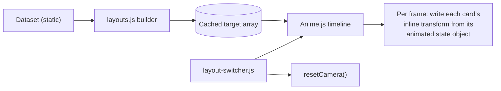
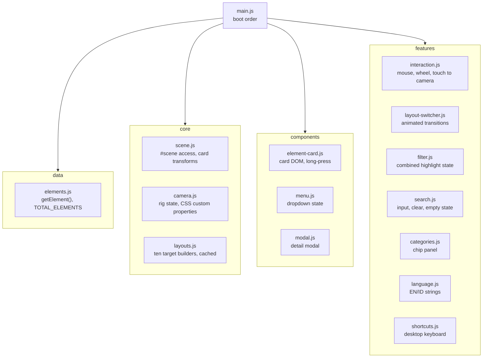

<h1 align="center">3D Periodic Table</h1>

<p align="center">
  All 118 elements in 3D space, built with pure CSS transforms.<br>
  Ten animated layouts, live search, category filters, and no build step.
</p>

<p align="center">
  
  
  
  
  
  
</p>

<p align="center">
  <a href="#overview">Overview</a> ·
  <a href="#layouts">Layouts</a> ·
  <a href="#quick-start">Quick start</a> ·
  <a href="#usage">Usage</a> ·
  <a href="#architecture">Architecture</a> ·
  <a href="#configuration">Configuration</a> ·
  <a href="#customization">Customization</a> ·
  <a href="#reference">Reference</a> ·
  <a href="#faq">FAQ</a>
</p>

<p align="center">
  <b>English</b> · <a href="./README.id.md">Bahasa Indonesia</a>
</p>

<!-- Add a demo link and a screenshot or GIF here once available. -->

---

## Overview

An interactive visualization of the complete periodic table. All 118 elements are cards placed in 3D space with CSS transforms. Rotate, pan and zoom the scene, hold any element for its details, switch between ten layouts with animated transitions, search instantly, and isolate whole element families with category filters.

> [!NOTE]
> **No build step, no framework, no install.** The project is plain HTML, CSS and ES modules served statically, roughly 2,800 lines of vanilla code. Anime.js, Font Awesome and Google Fonts load from CDNs at runtime.

### Highlights

| | |
|:--|:--|
| **118 element cards** | Per-category color theming with 10 palettes |
| **10 layouts** | Table, Sphere, Helix, Grid, Rings, Cylinder, Wave, DNA, Vortex, Torus, with staggered Anime.js transitions |
| **Full camera control** | Drag to rotate, right-drag or two-finger drag to pan, wheel or pinch to zoom |
| **Detail modal** | Long-press (0.5 s) shows mass, density, melting and boiling points |
| **Live search** | By name (either UI language), symbol or atomic number; matches glow while the rest fade, in every layout |
| **Category filters** | Ten chip toggles, composable with search; the panel opens on demand, starts closed and dismisses with outside taps or `Esc` |
| **Keyboard shortcuts** | Desktop only, with an in-app reference overlay |
| **Bilingual UI** | English and Indonesian, auto-detected from the browser locale |
| **Mobile-ready** | Safe-area aware on notched devices, touch gestures tuned for phones |

---

## Layouts

Every layout is a pure function from the dataset to one `{x, y, z, rx, ry, rz}` target per card, built once and cached. A single Anime.js timeline flies all 118 cards to their new targets with a stagger.

| Key | Shortcut | Shape |
|:--|:--:|:--|
| `table` | `1` | The classic flat table: 18 columns × 7 periods, with the f-block series on two extra rows below. |
| `sphere` | `2` | Fibonacci-sphere distribution, cards facing outward from the centre (the same spacing scheme as the classic CSS3D demo). |
| `helix` | `3` | A single vertical spiral: cards climb while circling the Y axis, always facing outward. |
| `grid` | `4` | 118 cards stacked as 5 × 5 slices receding into the distance along −Z. |
| `rings` | `5` | One concentric ring per period, staircased downward like a tilted wedding cake. The f-block series takes the two outermost rings. |
| `cylinder` | `6` | The 18 group columns wrapped around a vertical axis (groups 1 and 18 meet at the seam), each period a horizontal band. |
| `wave` | `7` | The flat table with a travelling sine offset in depth. Cards stay front-facing, so everything remains readable. |
| `dna` | `8` | Two intertwined strands: odd and even atomic numbers alternate between the sides of every rung. |
| `vortex` | `9` | An Archimedean spiral with exactly one full turn per period (alkali metals open each turn, noble gases close it), rising gently into a cone. The f-block sits on two rings inside the first turn. |
| `torus` | `0` | A donut: the 18 groups wrap around the tube so the table closes on itself, the 7 periods ride the tube cross-section (period 1 on top), and the f-block hangs as two stacked rings inside the hole. |

> [!TIP]
> Rings, vortex and torus are built flat on the XZ plane and tilted toward the camera as a rigid transform, so their silhouette reads from the default view. Torus cards also lean with the tube surface, and the inner half of the tube is flipped outward first so no near-side card ever shows its back.

---

## Quick start

> [!IMPORTANT]
> The app uses native ES modules, so it **must be served over HTTP**. Opening `index.html` through `file://` fails module loading in most browsers.

```bash
# from the project root, any static file server works
python3 -m http.server 8000
# or
npx serve .
```

Then open `http://localhost:8000`.

### Deploying

There is no build command and no output directory. The repository root is the deployable artifact.

| Host | Setup |
|:--|:--|
| **GitHub Pages** | Push the folder to a repository, then Settings → Pages → deploy from the branch root |
| **Netlify · Cloudflare Pages · Vercel** | Use the static-site preset, leave the build command empty |

CDN assets (Anime.js, Font Awesome, Google Fonts) are fetched at runtime, so viewers need internet access.

---

## Usage

### Controls

| Input | Action |
|:--|:--|
| Left-drag (mouse) · one-finger drag (touch) | Rotate the scene |
| Right-drag (mouse) · two-finger drag (touch) | Pan |
| Wheel (mouse) · pinch (touch) | Zoom |
| Press and hold an element (0.5 s) | Open the detail modal |
| Hamburger button (top left) | Layout switcher and language toggle |
| Search bar (top right) | Find elements by name, symbol or number |
| Shapes button (bottom left) | Category filter chips |

<details>
<summary><b>How gestures are arbitrated</b></summary>
<br>

A press that begins on an element card belongs to the card's long-press gesture first. The camera only starts following it once the pointer travels more than `SCENE_DRAG_THRESHOLD_PX` (10 px) from the press origin, at which point the pending hold cancels. Presses on empty space drive the camera immediately. This split keeps "hold to open details" reliable while preserving drag-to-rotate from anywhere.

A hold is cancelled when the pointer drifts more than 12 px, leaves the card, is interrupted by the system, or when a second finger joins (which turns the gesture into a pinch). Pinch engages instantly and zooms by finger spread.

During a layout transition the cards ignore the pointer entirely (`is-transitioning`), so presses never land on whichever card happens to sweep underneath.

</details>

### Keyboard shortcuts

Desktop only.

| Key | Action |
|:--|:--|
| `1`–`9`, `0` | Switch layout (table, sphere, helix, grid, rings, cylinder, wave, DNA, vortex, torus) |
| `E` / `I` | Switch language (English / Indonesian) |
| `R` | Reset the camera |
| `/` | Focus the search bar |
| `?` | Show or hide the shortcuts overlay |
| `Esc` | Close modal → menu → categories → overlay (topmost first) |

Single-key shortcuts are suppressed while typing in the search field and while modifier keys are held, so they never swallow regular input or browser shortcuts. On touch-first devices the help button and every keyboard binding are disabled entirely, since there is no hardware keyboard to serve.

### Search and category filters

Search and the category chips feed one shared highlight engine (`js/features/filter.js`), so the two features compose instead of fighting over the same cards.

- A card is **lit** when it matches the active query (if any) **and** belongs to an active category (if any).
- **Numeric queries** prefix-match the atomic number. Anything else matches the symbol or the English/Indonesian names, case-insensitively.
- Typing is debounced (120 ms) and identical filter combinations are skipped, so rapid input never churns 118 card styles for nothing.
- When nothing matches, a small empty-state bubble appears under the search bar.
- Dimmed cards fade to a ghost state and leave hit-testing entirely (`pointer-events: none`), so a press meant for a lit card never lands on a faded one stacked in front of it.
- `Esc` inside the search field clears it (or releases focus when already empty). The global `Esc` chain does not react to the same press.
- Clearing the input returns the scene to the category state if chips are still active, and to the resting look once every filter is off.

The categories panel starts closed, collapses while its chips are tapped (only the panel toggles), and closes on any press outside it. An indicator dot on the shapes button shows when filters are still active after the panel is gone.

### Languages

The UI ships in English and Indonesian. On first load the language is picked from the browser locale (an `id` language or `id` region tag selects Indonesian). Everything is translated:

- menu section labels, layout names and the language toggle
- search placeholder, clear button and the no-results message
- category chip names
- the interaction hint, modal field labels and the shortcuts overlay
- every on-card element title (for example *Sodium* ↔ *Natrium*)

Static markup declares its strings with `data-i18n` (text), `data-i18n-ph` (placeholder) or `data-i18n-aria` (aria-label). Dynamic consumers call `translate()` or subscribe with `onLanguageChange()`. Element property values in the modal (mass, density, temperatures) render exactly as stored in the dataset.

---

## Architecture

### Rendering model

There is no WebGL. `<body>` carries the CSS `perspective` (1200 px). `#scene` is a zero-size box anchored at the viewport centre that carries the whole camera transform. The 118 cards are its direct children, each moved with its own inline `translate3d(...) rotateY(...) rotateX(...) rotateZ(...)`.

> [!WARNING]
> Keep the camera transform on a single level. Nested transformed `preserve-3d` containers make Chromium miss the cards entirely during hit-testing, which is why the rig is deliberately not split into camera and rotator wrappers.

### Camera rig

`js/core/camera.js` owns five values (`camX`, `camY`, `camZ`, `rotX`, `rotY`) and flushes them to the document root as CSS custom properties (`--cam-x` … `--rot-y`) inside a `requestAnimationFrame` loop that only touches the DOM when something actually changed. Translation is clamped to `[CAMERA_MIN_Z, CAMERA_MAX_Z]` and pitch to ±90°.

Input from `js/features/interaction.js` arrives as small mutator calls (`addRotation`, `addPan`, `addZoom`, `setPinchZoom`). `resetCamera()` animates the rig back to its neutral pose and runs after every layout switch.

### Layout pipeline



Builders return one `{x, y, z, rx, ry, rz}` entry per dataset index (0–117). Rotations are in radians and match the transform order applied by `formatElementTransform()`. Cards face away from the vertical Y axis in the circular layouts (`ry = theta`), which is why horizontal shapes measure their angle from +Z, toward the default camera.

### Module graph



### Boot order

`main.js` wires everything in a deliberate sequence:

1. **Menu and modal**, because cards target them
2. **The 118 cards**
3. **Feature registries**: language, layout switcher, filter
4. **Search and categories**, so their strings exist before the first language pass
5. **Initial language and layout**
6. **Camera input and desktop shortcuts**, so every surface they may close is already in place when the first gesture arrives

### Project structure

```text
index.html                  markup: menu, search, categories, shortcuts, scene, modal
css/
  variables.css             design tokens, category palette, camera vars
  main.css                  base styles and the interaction hint
  menu.css                  hamburger, dropdown panel, language toggle
  search.css                search bar and empty-state bubble
  categories.css            category toggle button and chip panel
  shortcuts.css             shortcuts help button and overlay
  periodic-table.css        3D scene hierarchy, element cards, filter states
  modal.css                 element detail modal
  responsive.css            small-screen and touch adjustments
js/
  main.js                   entry point: wiring and boot order
  data/
    elements.js             dataset (10 fields per element, fixed stride)
  core/
    scene.js                scene DOM access, card transforms
    camera.js               camera rig state, CSS custom property output
    layouts.js              all ten layout target builders (table … torus)
  components/
    element-card.js         card DOM + long-press gesture
    menu.js                 dropdown open/close state
    modal.js                detail modal fill and dismiss
  features/
    interaction.js          mouse/wheel/touch input pipeline
    language.js             EN/ID strings and label switching
    layout-switcher.js      animated layout transitions
    filter.js               combined search + category highlight engine
    search.js               search input, clear, empty-state message
    categories.js           category chips and panel open/close state
    shortcuts.js            desktop keyboard bindings and reference overlay
  utils/
    helpers.js              shared constants and small utilities
archive/
  index.html                original single-file version, kept for reference
```

> [!NOTE]
> Every JS module opens with a block comment explaining its responsibility and the non-obvious decisions inside it. The comments are the design doc.

---

## Configuration

All tuning constants live in `js/utils/helpers.js`.

<details open>
<summary><b>Camera and input</b></summary>
<br>

| Constant | Value | Meaning |
|:--|:--|:--|
| `CAMERA_DEFAULT_Z` | `-2600` | Starting camera distance |
| `CAMERA_MIN_Z` / `CAMERA_MAX_Z` | `-6000` / `-500` | Zoom clamp |
| `ROTATION_MIN_X` / `ROTATION_MAX_X` | `-90°` / `90°` | Pitch clamp |
| `MOUSE_ROTATE_GAIN` | `0.3` | Pointer px → rotation |
| `MOUSE_PAN_GAIN` / `TOUCH_PAN_GAIN` | `2.5` | Pointer px → pan |
| `WHEEL_ZOOM_GAIN` | `2.0` | Wheel Δ → zoom |
| `TOUCH_ROTATE_GAIN` | `0.4` | Touch px → rotation |
| `TOUCH_PINCH_GAIN` | `5.0` | Finger-spread px → zoom |
| `SCENE_DRAG_THRESHOLD_PX` | `10` | Drag-vs-hold split point |
| `ELEMENT_HOLD_DURATION_MS` | `500` | Hold-to-modal duration |
| `ELEMENT_HOLD_DRIFT_PX` | `12` | Hold jitter tolerance |

</details>

<details>
<summary><b>Animation</b></summary>
<br>

| Constant | Value | Meaning |
|:--|:--|:--|
| `ANIME_LAYOUT_DURATION_MS` | `2000` | Layout flight, desktop |
| `ANIME_LAYOUT_STAGGER_MS` | `12` | Per-card delay, desktop |
| `ANIME_LAYOUT_DURATION_TOUCH_MS` | `1200` | Layout flight, touch devices |
| `ANIME_LAYOUT_STAGGER_TOUCH_MS` | `7` | Per-card delay, touch devices |
| `ANIME_CAMERA_RESET_MS` | `1500` | Camera reset flight |

</details>

<details>
<summary><b>Layout geometry</b></summary>
<br>

| Layout | Key constants |
|:--|:--|
| Table | Cell pitch 150 × 190 px, grid centre col 9.5 / row 5.5 |
| Sphere | Radius 1100 (Fibonacci distribution) |
| Helix | Radius 1000, 0.175 rad per element, −10 px climb per element |
| Grid | 5 × 5 slices, 400 px pitch, 1000 px apart in depth |
| Rings | Radius 230 + 95 per ring, 200 px tier drop, tilt 0.32 rad |
| Cylinder | Radius 460, 190 px band pitch, f-block tucks 1.4 rows below period 7 |
| Wave | Amplitude 260, frequencies 0.6 (column) / 0.5 (row) |
| DNA | Radius 650, 0.42 rad per rung, 11 px climb |
| Vortex | Radius 520 + 95 per turn, 150 px rise per turn, f-block hole radius 360 |
| Torus | Main radius 900, tube 220, hole rings at 560, tilt 0.58, surface pitch 0.42 |

Card dimensions (`--w: 130px`, `--h: 170px`) and the ten category colors (`--c-0` … `--c-9`) are CSS custom properties in `css/variables.css`.

</details>

---

## Customization

### Change the category colors

Edit `--c-0` … `--c-9` in `css/variables.css`. The triplets are consumed everywhere via `rgba(var(--color-rgb), α)`, so changing one line re-themes a whole family: cards, chips, modal tint and glows.

### Resize the cards

`--w` and `--h` in `css/variables.css` set the card box. `TABLE_CELL_W` and `TABLE_CELL_H` in `helpers.js` set the table-layout pitch.

> [!TIP]
> Keep the cell values at or above the card values so neighbouring cards do not overlap in the table layout.

### Add a new layout

Five touch points, roughly 50 lines:

| # | File | Change |
|:-:|:--|:--|
| 1 | `js/utils/helpers.js` | Geometry constants for the shape |
| 2 | `js/core/layouts.js` | A builder returning one `{x, y, z, rx, ry, rz}` per index, its exported name constant, an entry in `LAYOUT_NAMES`, a `get<Name>Layout()` accessor (caching follows the existing pattern), and a `case` in `getLayout()` |
| 3 | `index.html` | A `.layout-item` with `data-layout="myshape"` and `id="lbl-myshape"` |
| 4 | `js/features/language.js` | `myshape: 'MyShape'` in both the `EN` and `ID` string tables |
| 5 | `js/features/shortcuts.js` | A key binding in `onKeyDown()`, plus a matching row in the shortcuts overlay markup if it should be documented in-app |

Everything else composes automatically: the staggered transition, camera reset, hold-to-click, search glow, category filtering and aria states all operate at the card level and need no per-layout code.

### Edit the dataset

`js/data/elements.js` is a flat array with a fixed stride of 10 string/number fields per element (see [Dataset schema](#dataset-schema)). Keep the order atomic-number-ascending: the atomic number is derived from the array index, and several layouts sequence cards by index.

---

## Reference

### Performance notes

The touch-first device detection, `matchMedia('(hover: none) and (pointer: coarse)')`, is shared by every feature that branches on input style, so the CSS and JS stay consistent.

| Technique | Effect |
|:--|:--|
| **Shorter animations on touch** | The 118-card choreography runs on a 1200 ms clock with 7 ms stagger (vs 2000 ms / 12 ms on desktop), so fewer seconds of per-frame style writes keep switches fluid on mobile GPUs |
| **Cheaper card rendering on touch** | Layered box-shadows and symbol text-shadows, the most expensive effects per card, drop away. Borders and fills carry the look, and a single glow is kept only for the lit and pressing states |
| **Less backdrop blur** | Fixed UI surfaces use solid backgrounds on touch devices. Only the two panels keep a reduced blur |
| **Dirty-flag camera output** | CSS custom properties are written only in frames where a value actually changed |
| **Transition lock** | `is-transitioning` disables card pointer events during flight, preventing wasted hit-tests and misclicks |
| **Dimmed cards leave hit-testing** | Taps feel instant while a filter is active |
| **Static work happens once** | Layout targets are cached after first build, the filter skips redundant passes via its applied-state key, and search input is debounced |

### Accessibility

- Every control is a real `<button>` with a localized `aria-label`. The hamburger, categories panel and help button expose `aria-expanded`.
- Layout menu entries are `role="button"` with `tabindex="0"`, `aria-pressed` state and Enter/Space activation. Category chips expose `aria-pressed` too.
- The shortcuts overlay is `role="dialog"` with `aria-modal="true"`. `Esc` closes surfaces in precedence order (modal → menu → categories → overlay).
- All interactive elements show a visible `:focus-visible` outline in the accent color.
- Touch targets on small screens meet the 44 px minimum, and panels respect safe-area insets on notched devices.

### Dataset schema

`js/data/elements.js` stores each element as 10 consecutive fields.

| Offset | Field | Type | Example (Aluminium) |
|:-:|:--|:--|:--|
| 0 | `symbol` | string | `'Al'` |
| 1 | `nameEN` | string | `'Aluminium'` |
| 2 | `nameID` | string | `'Aluminium'` |
| 3 | `category` | 0–9 | `6` (post-transition) |
| 4 | `column` | 1–18 | `13` |
| 5 | `row` | 1–10 | `3` |
| 6 | `mass` | string | `'26.981 u'` |
| 7 | `density` | string | `'2.7 g/cm³'` |
| 8 | `meltingPoint` | string | `'660.32 °C'` |
| 9 | `boilingPoint` | string | `'2469.85 °C'` |

**Category indices** map to `--c-0` … `--c-9` in `css/variables.css`:

| 0 | 1 | 2 | 3 | 4 |
|:-:|:-:|:-:|:-:|:-:|
| Nonmetal | Noble gas | Alkali metal | Alkaline earth | Metalloid |

| 5 | 6 | 7 | 8 | 9 |
|:-:|:-:|:-:|:-:|:-:|
| Halogen | Post-transition metal | Transition metal | Lanthanide | Actinide |

Notes:

- The atomic number is **not stored**. It is the array index + 1.
- `column` and `row` drive the table and wave layouts. The f-block sits on rows 9–10 below the main grid.
- Values are rendered as-is, so data gaps appear as `N/A`, and carbon's sublimation points read `Menyublim`.

### Browser support

Any modern browser with CSS 3D transforms, ES modules and pointer events.

| Chrome / Edge | Firefox | Safari |
|:-:|:-:|:-:|
| 89+ | 89+ | 15+ |

The project targets evergreen browsers and ships no polyfills.

### Known limitations

> [!WARNING]
> - The detail modal is reachable only through the hold gesture. There is no keyboard-only path to it.
> - Motion does not respect `prefers-reduced-motion`. The app is inherently animated.
> - A few dataset values carry Indonesian tokens (`Menyublim`) regardless of the active UI language.
> - On very short screens the slide-in menu scrolls. It is capped at `100dvh − 90px` by design to stay reachable.

---

## FAQ

<details>
<summary><b>Nothing renders when I open <code>index.html</code> directly.</b></summary>
<br>
ES modules require HTTP. Serve the folder (<code>python3 -m http.server 8000</code>, <code>npx serve .</code>, or any static host) and open it through that.
</details>

<details>
<summary><b>Icons or fonts are missing.</b></summary>
<br>
They load from CDNs (Font Awesome, Google Fonts). An offline or firewall-restricted machine will show plain text, but the app itself still works.
</details>

<details>
<summary><b>Why did the help button disappear on my phone?</b></summary>
<br>
Keyboard shortcuts are a desktop-only feature. Touch-first devices hide the button and skip every keyboard binding.
</details>

<details>
<summary><b>The scene starts too far away or too close.</b></summary>
<br>
Wheel or pinch to zoom. <code>R</code> (desktop) resets the camera to its default distance of −2600 px. Adjust <code>CAMERA_DEFAULT_Z</code> in <code>helpers.js</code> to change the starting distance permanently.
</details>

<details>
<summary><b>Can elements open with a quick click instead of a 0.5 s hold?</b></summary>
<br>
Lower <code>ELEMENT_HOLD_DURATION_MS</code> (for example <code>150</code>). The drift protection still cancels the hold if you start dragging.
</details>

<details>
<summary><b>How do I reset everything?</b></summary>
<br>
<code>R</code> resets the camera. Reselecting the current layout is a no-op, so pick another layout and switch back, or just reload.
</details>

---

## Credits

- Interaction and layout math inspired by the [Three.js CSS3D periodic table demo](https://threejs.org/examples/#css3d_periodictable), re-implemented here with plain DOM and CSS transforms instead of WebGL
- [Anime.js](https://animejs.com) by Julian Garnier for layout and camera animations (MIT)
- [Font Awesome Free](https://fontawesome.com) for icons (CC BY 4.0 / OFL / MIT)
- [Google Fonts](https://fonts.google.com): Outfit, JetBrains Mono, Share Tech Mono (OFL)


