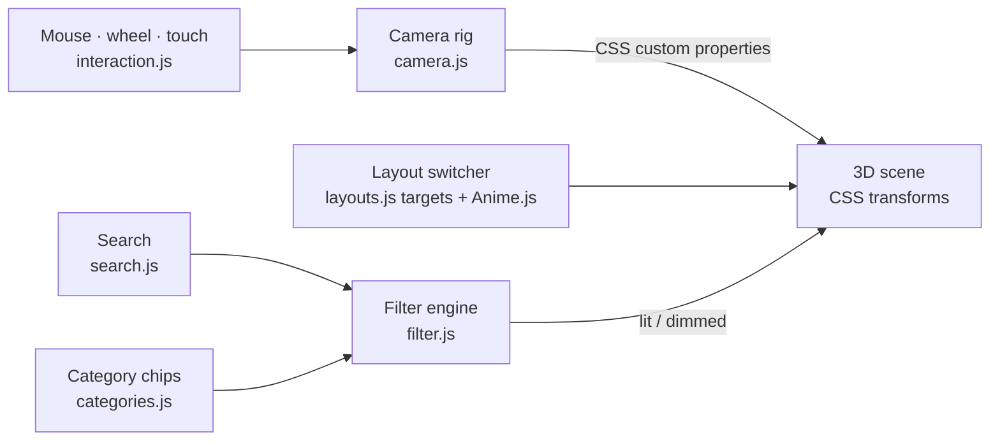

<div align="center">

# 3D Periodic Table

**All 118 elements, laid out in 3D space with nothing but CSS transforms.**

Rotate, pan and zoom the scene. Hold an element for its details,<br>
switch between four layouts, search instantly and isolate whole families.

<br>


[Quick start](#quick-start) &nbsp;·&nbsp;
[Controls](#controls) &nbsp;·&nbsp;
[How it works](#how-it-works) &nbsp;·&nbsp;
[Dataset](#dataset) &nbsp;·&nbsp;
[Configuration](#configuration) &nbsp;·&nbsp;
[Browser support](#browser-support)

</div>

<br>

## Overview

3D Periodic Table is an interactive visualization of the complete periodic table. Every element is a card positioned in 3D with **pure CSS transforms**: no WebGL, no canvas, no framework.

It is a static site. There is no build step and nothing to install, just plain HTML, CSS and native ES modules served over HTTP.

| | |
|---|---|
| **Zero tooling** | No bundler, no package manager, no dependencies to install. |
| **Explore, not just look** | Orbit the scene, jump between layouts, search by name or number, filter by family. |
| **Works on touch** | Gestures are tuned for mobile and the UI respects device safe areas. |

<br>

## Features

| Capability | Details |
|---|---|
| **118 element cards** | Per-category color theming with 10 palettes. |
| **4 layouts** | Table, Sphere, Helix and Grid, with staggered [Anime.js](https://animejs.com) transitions between them. |
| **Full camera control** | Drag to rotate, right-drag or two-finger drag to pan, wheel or pinch to zoom. |
| **Detail modal** | Press and hold a card (0.5 s) to see mass, density, melting and boiling points. |
| **Live search** | By name (either UI language), symbol or atomic number. Matches glow while the rest fade, in every layout. |
| **Category filters** | Ten chip toggles, from nonmetal to actinide, that light up whole element families. They compose with search. |
| **Keyboard shortcuts** | Desktop only, with an in-app reference overlay. |
| **Bilingual UI** | English and Indonesian, auto-detected from the browser locale. |

<br>

## Quick start

```bash
# from the project root, any static file server works
python3 -m http.server 8000
# or
npx serve .
```

Then open <http://localhost:8000>.

> [!IMPORTANT]
> The app uses native ES modules, so it must be served over HTTP. Opening `index.html` through `file://` fails module loading in most browsers.

<br>

## Controls

| Input | Action |
|---|---|
| Left-drag (mouse) / one-finger drag (touch) | Rotate the scene |
| Right-drag (mouse) / two-finger drag (touch) | Pan |
| Wheel (mouse) / pinch (touch) | Zoom |
| Press and hold an element (0.5 s) | Open the detail modal |
| Hamburger button | Layout switcher and language toggle |
| Search bar (top right) | Find elements by name, symbol or number |
| Shapes button (bottom left) | Category filter chips |

Search and category filters compose: a card stays lit only when it matches **both**. Dimmed cards remain interactive, so a filter never blocks exploration.

### Keyboard shortcuts

*Desktop only.*

| Key | Action |
|---|---|
| `1` `2` `3` `4` | Switch layout (table / sphere / helix / grid) |
| `E` / `I` | Switch language (English / Indonesian) |
| `R` | Reset the camera |
| `/` | Focus the search bar |
| `?` | Show or hide the shortcuts overlay |
| `Esc` | Close modal → menu → categories → overlay (topmost first) |

Single-key shortcuts are suppressed while typing in the search field and while modifier keys are held. On touch-first devices the help button and every keyboard binding are disabled entirely.

> [!NOTE]
> Presses that start on an element card are reserved for the long-press gesture. The camera only follows a press once it moves past a small drag threshold, so holding a card never rotates the scene by accident.

<br>

## How it works



| Piece | Responsibility |
|---|---|
| **Camera** | Holds the rig state (rotation, pan, zoom) and writes it out as CSS custom properties, so the browser does the 3D work. |
| **Layouts** | Computes a target position per element for each layout; transitions are animated and staggered. |
| **Filter engine** | Combines the search query and the active category chips into one lit / dimmed state per card. |
| **Cards** | Own their DOM and the long-press gesture that opens the modal. |

<br>

## Project structure

<details>
<summary><b>Show full tree</b></summary>

```
index.html                  markup: menu, search, categories, shortcuts, scene, modal
css/
  variables.css             design tokens, category palette, camera vars
  main.css                  base styles and the interaction hint
  menu.css                  hamburger, dropdown panel, language toggle
  search.css                search bar and empty-state bubble
  categories.css            category toggle button and chip panel
  shortcuts.css             shortcuts help button and overlay
  periodic-table.css        3D scene hierarchy, element cards, filter states
  modal.css                 element detail modal
  responsive.css            small-screen and touch adjustments
js/
  main.js                   entry point: wiring and boot order
  data/
    elements.js             dataset (10 fields per element, fixed stride)
  core/
    scene.js                scene DOM access, card transforms
    camera.js               camera rig state, CSS custom property output
    layouts.js              table / sphere / helix / grid target math
  components/
    element-card.js         card DOM + long-press gesture
    menu.js                 dropdown open/close state
    modal.js                detail modal fill and dismiss
  features/
    interaction.js          mouse/wheel/touch input pipeline
    language.js             EN/ID strings and label switching
    layout-switcher.js      animated layout transitions
    filter.js               combined search + category highlight engine
    search.js               search input, clear, empty-state message
    categories.js           category chips and panel open/close state
    shortcuts.js            desktop keyboard bindings and reference overlay
  utils/
    helpers.js              shared constants and small utilities
archive/
  index.html                original single-file version, kept for reference
```

</details>

<br>

## Configuration

All tuning constants live in `js/utils/helpers.js`.

| Group | What you can tune |
|---|---|
| Layout geometry | Cell pitch, sphere radius, helix and grid spacing |
| Camera | Limits and rotation clamps |
| Input | Gains, hold duration, drag thresholds |
| Animation | Transition timings |

Category colors are defined in `css/variables.css` as `--c-0` through `--c-9`.

<br>

## Dataset

`js/data/elements.js` is a flat array with a **fixed stride of 10 fields** per element.

| Index | Field | Notes |
|---|---|---|
| 0 | Symbol | |
| 1 | English name | |
| 2 | Indonesian name | |
| 3 | Category | `0`–`9`, mapped to the CSS palette |
| 4 | Table column | |
| 5 | Table row | f-block sits on rows 9–10, below the main grid |
| 6 | Atomic mass | |
| 7 | Density | |
| 8 | Melting point | |
| 9 | Boiling point | |

Values are strings rendered as-is. Gaps in the underlying data appear as `N/A`, and sublimating elements as `Menyublim`.

<br>

## Browser support

Any modern browser with CSS 3D transforms, ES modules and pointer events.

| Browser | Minimum |
|---|---|
| Chrome / Edge | 89+ |
| Firefox | 89+ |
| Safari | 15+ |

The layout intentionally targets evergreen browsers. No polyfills are shipped.

<br>

## Credits

- Interaction and layout math inspired by the [Three.js CSS3D periodic table demo](https://threejs.org/examples/#css3d_periodictable), re-implemented with plain DOM and CSS transforms instead of WebGL
- [Anime.js](https://animejs.com) by Julian Garnier: layout and camera animations (MIT)
- [Font Awesome Free](https://fontawesome.com): icons (CC BY 4.0 / OFL / MIT)
- [Google Fonts](https://fonts.google.com): Outfit, JetBrains Mono, Share Tech Mono (OFL)

<br>

## License

Provided as-is for educational purposes. The element property data is compiled from public chemistry references (IUPAC standard atomic weights and common textbooks).
